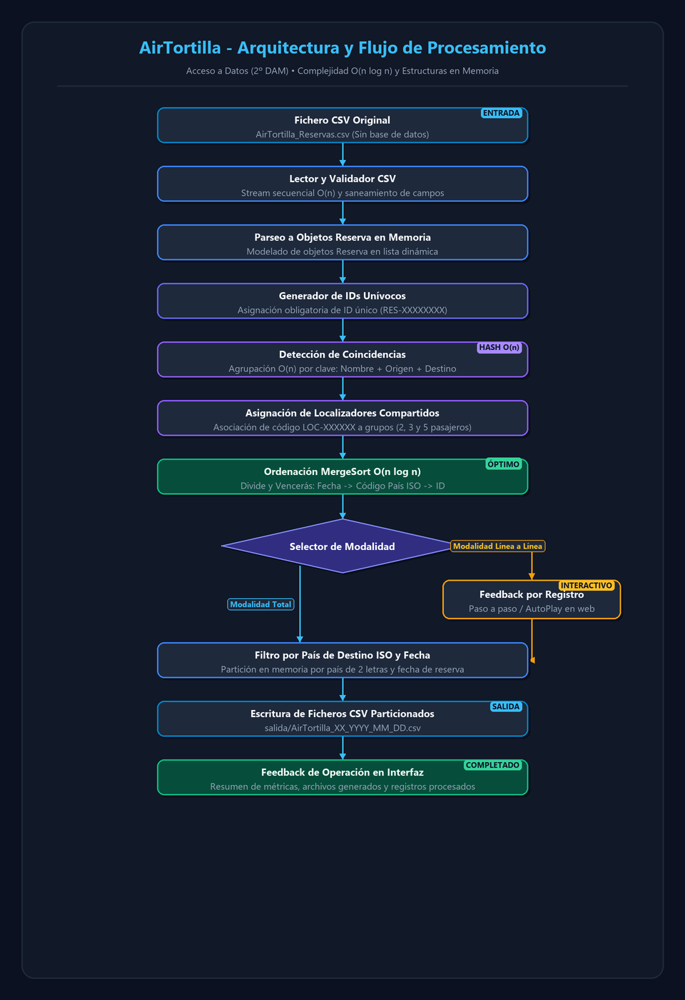

# AirTortilla - Sistema de Procesamiento de Reservas

Proyecto de gestión, procesamiento y distribución de reservas aéreas por país de destino desarrollado para la asignatura de Acceso a Datos (2º DAM).

---

## 1. Descripción del Proyecto

AirTortilla requiere una solución de alto rendimiento para procesar un fichero original de reservas en formato CSV sin utilizar bases de datos relacionales ni externas.

El sistema realiza:
1. **Lectura y parseo:** Carga y conversión de datos en objetos en memoria `Reserva`.
2. **Identificación unívoca:** Generación de un identificador único por reserva.
3. **Generación de localizadores:** Asignación de un código de localizador común para pasajeros coincidentes (mismo nombre, origen y destino).
4. **Ordenación eficiente:** Aplicación de algoritmos de complejidad $O(n \log n)$ (MergeSort).
5. **Filtrado y particionado:** División de reservas por código ISO de 2 letras del país de destino y fecha.
6. **Exportación:** Generación de ficheros CSV independientes con nomenclatura `AirTortilla_XX_YYYY_MM_DD.csv`.
7. **Interfaz dual:** Modalidad de ejecución total y modalidad paso a paso (línea a línea).

---

## 2. Diccionario de Datos

Estructura de datos utilizada para el modelado y la persistencia de las reservas en ficheros CSV:

| Campo | Tipo de Dato | Formato / Ejemplo | Descripción |
| :--- | :--- | :--- | :--- |
| `id` | `String` (UUID / Alfanumérico) | `RES-8F4A1C92` | Identificador unívoco obligatorio de cada reserva. |
| `nombre_pasajero` | `String` | `Carlos Martinez` | Nombre completo del viajero. |
| `origen` | `String` | `Madrid` | Ciudad o aeropuerto de salida. |
| `destino` | `String` | `Paris` | Ciudad o aeropuerto de llegada. |
| `codigo_pais_destino` | `String` (ISO 3166-1 alpha-2) | `FR` | Código de 2 caracteres del país de destino. |
| `fecha_reserva` | `LocalDate` | `YYYY-MM-DD` (ej. `2020-05-15`) | Fecha de emisión de la reserva. |
| `localizador` | `String` | `LOC-98231` / `N/A` | Código asignado a reservas agrupadas con mismo pasajero, origen y destino. |

---

## 3. Análisis de Complejidad Algorítmica (Big O)

El sistema procesa volúmenes elevados de registros en memoria sin apoyo de motores de indexación de base de datos, por lo que la eficiencia algorítmica es un factor crítico.

### Escalas de Complejidad
- **$O(1)$ - Tiempo Constante:** Accesos directos a memoria, inserciones y consultas en tablas hash (`HashMap` o `HashSet`), apertura y cierre de descriptores de ficheros.
- **$O(n)$ - Tiempo Lineal:** Recorrido secuencial de las líneas del fichero CSV y parseo de registros individuales.
- **$O(n \log n)$ - Tiempo Lineal-Logarítmico (Objetivo de Ordenación):** Límite inferior óptimo para algoritmos de ordenación basados en comparación.
- **$O(n^2)$ - Tiempo Cuadrático (Prohibido):** Bucles anidados de comparación exhaustiva. Se evita expresamente mediante estructuras asociativas hash y algoritmos divide y vencerás.

### Algoritmo MergeSort ($O(n \log n)$)
Para la ordenación de las entidades `Reserva` se implementa MergeSort (Ordenación por Mezcla):
1. **Fase Divide:** Descompone recursivamente la lista de $n$ elementos en dos sublistas de tamaño $\frac{n}{2}$ hasta alcanzar listas unitarias (caso base trivial ya ordenado). Esta descomposición genera un árbol de recursión de profundidad $\log_2(n)$.
2. **Fase Vence (Merge):** Fusiona de manera ordenada pares de sublistas comparando los elementos frontales en tiempo lineal $O(n)$ por nivel.
3. **Cálculo de coste total:** $n \times \log_2(n) \rightarrow O(n \log n)$, tanto en el mejor, como en el caso medio y peor caso, ofreciendo estabilidad temporal garantizada.

---

## 4. Diagrama de Flujo del Sistema



---

## 5. Requisitos de Ejecución y Entorno
- **Lenguaje:** Java (SE 17 o superior)
- **Control de versiones:** Git
- **Restricción de datos:** Los ficheros CSV de datos no forman parte del repositorio (`.gitignore`).

---

## 6. Entrega 2: Migración a Base de Datos Relacional y Control de Acceso

En esta segunda entrega se da respuesta a las nuevas obligaciones legales y de seguridad de AirTortilla, implementando la persistencia en una Base de Datos Relacional, autenticación por roles, alta de usuarios y trazabilidad inmutable.

### 6.1. Desglose de User Stories en Tareas Medibles

En conformidad con el objetivo de convertir las User Stories en un conjunto de tareas medibles, se establece el siguiente desglose de trabajo:

| ID Tarea | User Story Relacionada | Descripción de la Tarea Técnica | Criterio de Aceptación Medible | Estado |
| :--- | :--- | :--- | :--- | :---: |
| **T2.1** | **US1 (Empleado)**: Poder hacer log in para acceder a recursos | Creación de tabla `usuarios`, servicio `AutenticacionService` con hash SHA-256 y endpoint `POST /api/auth/login`. | El empleado inicia sesión con sus credenciales y se valida su rol y estado activo. | **Completada** |
| **T2.2** | **US2 (Admin)**: Dar de alta usuarios para garantizar seguridad | Implementación de `UsuarioDAO.insertar`, validación de unicidad de username y restricción exclusiva al rol `ADMIN`. | Un usuario no admin recibe `403 Forbidden`; un admin registra nuevos usuarios exitosamente. | **Completada** |
| **T2.3** | **US3 (Admin)**: Mantener trazabilidad de las modificaciones | Creación de tabla `auditoria` y servicio `AuditoriaService` para registrar automáticamente accesos, altas y migraciones. | Cada evento clave guarda: fecha/hora, usuario, acción, entidad, detalles e IP de origen. | **Completada** |
| **T2.4** | **Legislación BD**: Migración a Base de Datos Relacional | Creación de tabla `reservas`, servicio `MigracionRelacionalService` y script SQL centralizado. | Las reservas se migran e indexan en SQLite preservando integridad y ordenación. | **Completada** |
| **T2.5** | **Infraestructura**: Contenedor virtual para despliegues | Confección de `Dockerfile` multi-stage y `docker-compose.yml`. | La aplicación se compila y levanta en contenedor virtual accesible en el puerto 8080. | **Completada** |

---

### 6.2. Archivo Centralizado de Consultas SQL (`sql/consultas.sql`)

Todas las definiciones DDL y sentencias DML se encuentran centralizadas en el archivo [`sql/consultas.sql`](file:///sql/consultas.sql), estructuradas en:
1. **DDL de Tablas e Índices:**
   - `usuarios`: Gestión de credenciales seguras (SHA-256), roles (`ADMIN`, `EMPLEADO`) y estado de actividad.
   - `reservas`: Estructura relacional con claves primarias e índices en `(codigo_pais_destino, fecha_reserva)` y `localizador`.
   - `auditoria`: Bitácora cronológica indexada para consultas de trazabilidad de seguridad.
2. **DML de Autenticación y Operaciones:**
   - Consultas parametrizadas para login, alta de usuario, inserción por lotes (`batch`) y consultas ordenadas equivalentes a la ordenación MergeSort.

---

### 6.3. Cuentas de Acceso Predeterminadas (Semilla)

Al iniciar la aplicación por primera vez, el sistema genera automáticamente las credenciales de prueba en la base de datos relacional:

| Rol | Usuario | Contraseña | Permisos |
| :--- | :--- | :--- | :--- |
| **ADMIN** | `admin` | `admin123` | Control total: Procesamiento, alta de usuarios (US2) y auditoría (US3). |
| **EMPLEADO** | `empleado` | `empleado123` | Acceso operativo: Procesamiento de reservas y consulta de ficheros. |

---

### 6.4. Novedades en la Interfaz de Usuario y API REST

1. **Pestañas de Navegación:**
   - **✈ Procesamiento:** Flujo existente de modalidad Total y Línea a Línea, ahora con persistencia automática en base de datos.
   - **👥 Gestión de Usuarios (US2):** Formulario de alta rápida y tabla en vivo de usuarios registrados (restringido a administradores).
   - **🛡 Trazabilidad y Seguridad (US3):** Histórico de eventos de auditoría en tiempo real con detalle de usuario, acción, entidad y marcas de tiempo.
   - **🗄 Migración Relacional:** Panel con estado del motor SQL y botón de sincronización directa CSV ➔ SQLite.
2. **Modal de Login (US1):**
   - Modal flotante con selector de credenciales y botones de autorelleno para agilizar las pruebas del profesor.
3. **Consola y CLI:**
   - El menú de terminal (`Main.java`) incorpora opciones para autenticación, alta de usuarios, consulta de bitácora y sincronización relacional.

---

### 6.5. Despliegue en Contenedores Virtuales (Docker)

Para facilitar los despliegues de la aplicación sin dependencias locales:

```bash
# Construir y levantar el contenedor con Docker Compose
docker-compose up --build -d

# Acceder a la interfaz web
http://localhost:8080
```

---

### 6.6. Verificación Automatizada

Se incluye la clase [`PruebasEntrega2.java`](file:///src/com/airtortilla/test/PruebasEntrega2.java) para validar de manera desatendida todos los requisitos:

```bash
# Ejecutar verificación de la Entrega 2
java -cp "bin;lib/*" com.airtortilla.test.PruebasEntrega2
```
