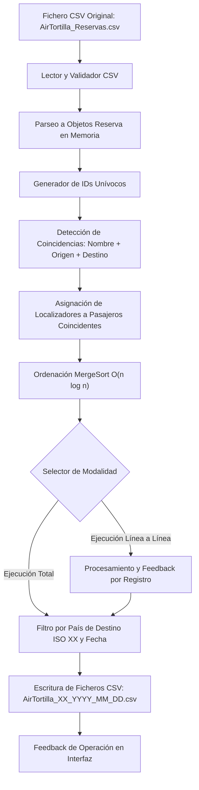

# AirTortilla - Sistema de Procesamiento de Reservas

Proyecto de gestión, procesamiento y distribución de reservas aéreas por país de destino desarrollado para la asignatura de Acceso a Datos (2º DAM).

---

## 1. Descripción del Proyecto

AirTortilla requiere una solución de alto rendimiento para procesar un fichero original de reservas en formato CSV sin utilizar bases de datos relacionales ni externas.

El sistema realiza:
1. **Lectura y parseo:** Carga y conversión de datos en objetos en memoria `Reserva`.
2. **Identificación unívoca:** Generación de un identificador único por reserva.
3. **Generación de localizadores:** Asignación de un código de localizador común para pasajeros coincidentes (mismo nombre, origen y destino).
4. **Ordenación eficiente:** Aplicación de algoritmos de complejidad $O(n \log n)$ (MergeSort).
5. **Filtrado y particionado:** División de reservas por código ISO de 2 letras del país de destino y fecha.
6. **Exportación:** Generación de ficheros CSV independientes con nomenclatura `AirTortilla_XX_YYYY_MM_DD.csv`.
7. **Interfaz dual:** Modalidad de ejecución total y modalidad paso a paso (línea a línea).

---

## 2. Diccionario de Datos

Estructura de datos utilizada para el modelado y la persistencia de las reservas en ficheros CSV:

| Campo | Tipo de Dato | Formato / Ejemplo | Descripción |
| :--- | :--- | :--- | :--- |
| `id` | `String` (UUID / Alfanumérico) | `RES-8F4A1C92` | Identificador unívoco obligatorio de cada reserva. |
| `nombre_pasajero` | `String` | `Carlos Martinez` | Nombre completo del viajero. |
| `origen` | `String` | `Madrid` | Ciudad o aeropuerto de salida. |
| `destino` | `String` | `Paris` | Ciudad o aeropuerto de llegada. |
| `codigo_pais_destino` | `String` (ISO 3166-1 alpha-2) | `FR` | Código de 2 caracteres del país de destino. |
| `fecha_reserva` | `LocalDate` | `YYYY-MM-DD` (ej. `2020-05-15`) | Fecha de emisión de la reserva. |
| `localizador` | `String` | `LOC-98231` / `N/A` | Código asignado a reservas agrupadas con mismo pasajero, origen y destino. |

---

## 3. Análisis de Complejidad Algorítmica (Big O)

El sistema procesa volúmenes elevados de registros en memoria sin apoyo de motores de indexación de base de datos, por lo que la eficiencia algorítmica es un factor crítico.

### Escalas de Complejidad
- **$O(1)$ - Tiempo Constante:** Accesos directos a memoria, inserciones y consultas en tablas hash (`HashMap` o `HashSet`), apertura y cierre de descriptores de ficheros.
- **$O(n)$ - Tiempo Lineal:** Recorrido secuencial de las líneas del fichero CSV y parseo de registros individuales.
- **$O(n \log n)$ - Tiempo Lineal-Logarítmico (Objetivo de Ordenación):** Límite inferior óptimo para algoritmos de ordenación basados en comparación.
- **$O(n^2)$ - Tiempo Cuadrático (Prohibido):** Bucles anidados de comparación exhaustiva. Se evita expresamente mediante estructuras asociativas hash y algoritmos divide y vencerás.

### Algoritmo MergeSort ($O(n \log n)$)
Para la ordenación de las entidades `Reserva` se implementa MergeSort (Ordenación por Mezcla):
1. **Fase Divide:** Descompone recursivamente la lista de $n$ elementos en dos sublistas de tamaño $\frac{n}{2}$ hasta alcanzar listas unitarias (caso base trivial ya ordenado). Esta descomposición genera un árbol de recursión de profundidad $\log_2(n)$.
2. **Fase Vence (Merge):** Fusiona de manera ordenada pares de sublistas comparando los elementos frontales en tiempo lineal $O(n)$ por nivel.
3. **Cálculo de coste total:** $n \times \log_2(n) \rightarrow O(n \log n)$, tanto en el mejor, como en el caso medio y peor caso, ofreciendo estabilidad temporal garantizada.

---

## 4. Diagrama de Flujo del Sistema

> **Espacio reservado para diagrama visual:**
> 
> *Inserte aquí la imagen generada desde Draw.io / Excalidraw:*
> 
> ``

---

## 5. Requisitos de Ejecución y Entorno
- **Lenguaje:** Java (SE 17 o superior)
- **Control de versiones:** Git
- **Restricción de datos:** Los ficheros CSV de datos no forman parte del repositorio (`.gitignore`).
